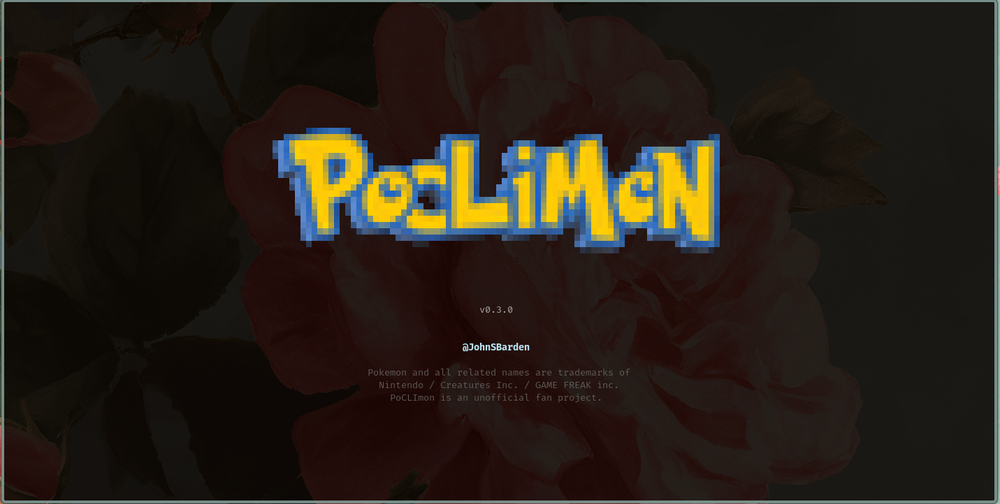
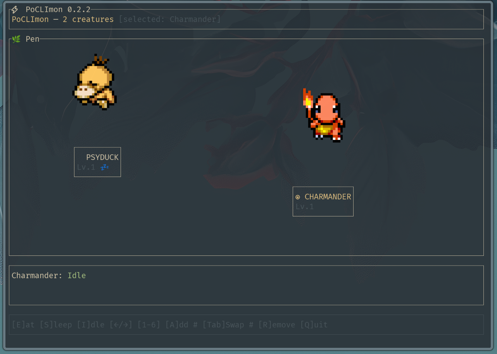

# PoCLImon



**Pokemon living in your terminal.** Eat, sleep, play. 🕹️

```
poclimon
```



---

## Features

- Animated sprite art in your terminal — Kitty, Sixel, iTerm2, and halfblock for the rest
- Up to 6 creatures sharing one open pen with elastic collision physics
- Feed, sleep, play, and idle animations
- XP and leveling — creatures gain XP as you interact with them (and slowly while idle); level persists across sessions
- Unlocks — base forms are free, evolved forms are earned
- Add, remove, and swap creatures live with no restart and no config editing
- Roster persistence — creature state (XP, level) kept in a signed save, written on quit and every 30 s
- Full Gen 1–9 Pokédex: any of 1025 creatures by National Dex ID
- Sprites cached to `~/.config/poclimon/sprites/` — downloaded once, Bill's PC keeps the rest
- TOML config

---

## Installation

```bash
git clone https://github.com/JohnSBarden/poclimon.git
cd poclimon
cargo install --path .
```

Requires Rust + Cargo. If you don't have it, go to [rustup.rs](https://rustup.rs) — it's super effective.

---

## Usage

```bash
poclimon                           # loads ~/.config/poclimon.toml
poclimon --creature pikachu        # single creature, no config needed
poclimon --config ./my-roster.toml # custom config
```

---

## Controls

| Key         | Action                                                                    |
| ----------- | ------------------------------------------------------------------------- |
| `E`         | Feed selected creature                                                    |
| `S`         | Put selected creature to sleep                                            |
| `I`         | Return to idle                                                            |
| `A`         | Add a creature (enter Pokédex ID)                                         |
| `R`         | Release selected creature (requires 2+ — you can't release your last one) |
| `Tab`       | Swap selected creature (enter Pokédex ID)                                 |
| `V`         | Evolve selected creature once its nameplate shows ✨ (pick a branch with 1–3) |
| `P`         | Play with selected creature                                               |
| `←` / `→`   | Cycle selection                                                           |
| `1`–`6`     | Select by slot number                                                     |
| `Q` / `Esc` | Quit (your creatures go back into the PC)                                 |

---

## Configuration

`~/.config/poclimon.toml` is conjured on first run. You can bypass it with `--creature` or `--config`. It holds settings only, and it's safe to edit:

```toml
[display]
scale = 3  # sprite scale multiplier, 1-8 — memory scales quadratically, 3 is the sweet spot
```

### Your save

Your Pokémon (species, levels, XP, unlocks) live in `~/.config/poclimon/save.toml`. It's readable TOML, but it's **signed**: edit it by hand and PoCLImon won't load it. The edited file is kept as `save.toml.rejected-<time>`, and the game restores `save.toml.bak`, the previous good save. Earn your Charizard the honest way.

Rosters stored in `poclimon.toml` by v0.5.x and earlier are moved into the signed save automatically on the first run of a version with signing.

Builds without the release key (`cargo build`, `cargo install`) use a public dev key and a separate `save.dev.toml`, so they never touch a release save.

---

## Starter Roster

You start with Bulbasaur, Charmander, Squirtle, Pikachu and Eevee. Hit `A` to add more live, or `Tab` to swap, by Pokédex number.

**What you can pick:** any **base form** (562 of the 1025, from Bulbasaur to Mewtwo), plus anything you've **unlocked by evolving** into it. Evolved forms like Ivysaur or Charizard are locked until you earn them. Species whose pre-evolution is a baby (Pikachu, Snorlax, Clefairy...) count as base forms, and Vaporeon, Jolteon and Flareon stay pickable until item evolution exists.

**Leveling:** Eat or Play earns 2 XP/s for 10 s, then 1 XP/s up to 40 s. Every other moment earns 0.1 XP/s, so a pen left running still grows. Level *n* → *n*+1 takes 50 × *n* XP. When a creature reaches its real evolution level (Bulbasaur at 16, Charmeleon at 36...), its nameplate shows `✨`. Press `V` to evolve it right in the pen: it keeps its level, XP and spot, and the new species is unlocked for Add/Swap. Item, trade and friendship evolutions (Eevee, Pikachu → Raichu...) come later.

---

## Terminal Compatibility

| Terminal                  | Protocol          | Notes                            |
| ------------------------- | ----------------- | -------------------------------- |
| Ghostty, Kitty            | Kitty graphics    | It's super effective             |
| iTerm2                    | iTerm2 inline     | It's super effective             |
| WezTerm, foot             | Sixel             | Very effective                   |
| Alacritty, macOS Terminal | Halfblock unicode | Not very effective, but it works |

---

## Credits

Sprites from [PMDCollab SpriteCollab](https://sprites.pmdcollab.org/) — community PMD sprite sheets, licensed **CC BY-NC**.

Evolution data generated from [PokeAPI](https://github.com/PokeAPI/pokeapi) — **BSD-3-Clause**.

Pokémon is a trademark of Nintendo / Game Freak / The Pokémon Company. This project is unofficial and non-commercial. For funsies. 🫰
